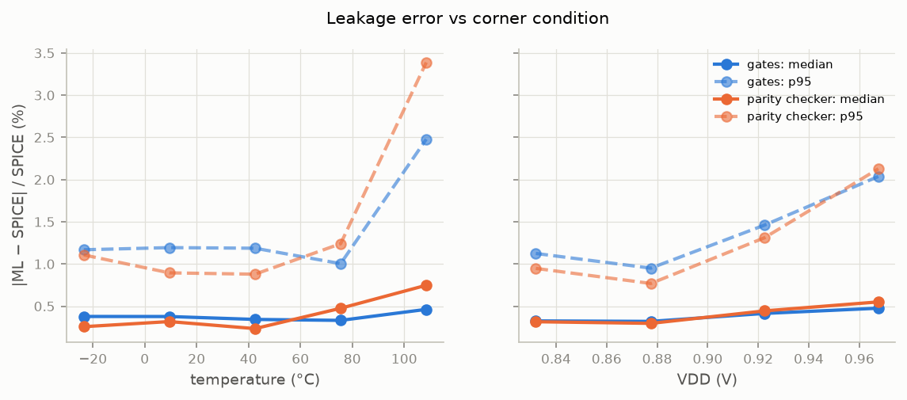

# Error analysis

## Part A: chosen transistor models on the test set

Median / p95 of the worst of id, ig and is per sample, by input range. The body current ib is listed separately: in the OFF cases it is ~1e-14 A, 6-8 decades below the logic-gate leakages, and it would otherwise dominate the statistics. This per-sample worst-of-three metric is stricter than the pooled metric of reports/partA/MODELS.md, so its p95 values are higher.

**NMOS_ON** (worst of id, ig, is per sample; ib: median 0.14 %, p95 0.5 %, median |ib| 2.0e-12 A):
- temperature: -40–-7 °C: 0.25 / 7.2 % | -7–26 °C: 0.22 / 1.0 % | 26–59 °C: 0.21 / 0.8 % | 59–92 °C: 0.21 / 0.7 % | 92–125 °C: 0.22 / 0.8 %
- vth0 deviation: -10–-5 %: 0.22 / 0.8 % | -5–0 %: 0.21 / 1.0 % | 0–5 %: 0.22 / 1.1 % | 5–10 %: 0.24 / 1.9 %
- toxe deviation: -10–-5 %: 0.24 / 0.9 % | -5–0 %: 0.21 / 1.4 % | 0–5 %: 0.20 / 0.8 % | 5–10 %: 0.23 / 1.5 %
- |Vd − Vs|: 0–0.01 V: 0.76 / 344.1 % | 0.01–0.05 V: 0.35 / 74.8 % | 0.05–0.2 V: 0.28 / 2.0 % | 0.2–0.5 V: 0.20 / 0.6 % | 0.5–1 V: 0.18 / 0.4 %
- current with the largest p95: is (p95 0.7 %); worst single error 78059 % on id at |I| = 1.59e-12 A

**NMOS_OFF** (worst of id, ig, is per sample; ib: median 0.51 %, p95 22.0 %, median |ib| 1.0e-14 A):
- temperature: -40–-7 °C: 0.47 / 4.6 % | -7–26 °C: 0.42 / 2.1 % | 26–59 °C: 0.34 / 1.8 % | 59–92 °C: 0.48 / 1.8 % | 92–125 °C: 0.49 / 2.0 %
- vth0 deviation: -10–-5 %: 0.47 / 2.5 % | -5–0 %: 0.41 / 1.9 % | 0–5 %: 0.39 / 2.0 % | 5–10 %: 0.46 / 2.9 %
- toxe deviation: -10–-5 %: 0.46 / 2.1 % | -5–0 %: 0.41 / 2.3 % | 0–5 %: 0.39 / 2.2 % | 5–10 %: 0.48 / 2.7 %
- |Vd − Vs|: 0–0.01 V: 0.61 / 3.6 % | 0.01–0.05 V: 0.42 / 2.4 % | 0.05–0.2 V: 0.34 / 1.6 % | 0.2–0.5 V: 0.44 / 1.8 % | 0.5–1 V: 0.71 / 4.2 %
- current with the largest p95: ib (p95 22.0 %); worst single error 1500 % on ib at |I| = 2.07e-16 A

**PMOS_ON** (worst of id, ig, is per sample; ib: median 0.13 %, p95 0.5 %, median |ib| 7.1e-12 A):
- temperature: -40–-7 °C: 0.23 / 0.9 % | -7–26 °C: 0.22 / 1.0 % | 26–59 °C: 0.20 / 0.7 % | 59–92 °C: 0.20 / 0.9 % | 92–125 °C: 0.24 / 0.7 %
- vth0 deviation: -10–-5 %: 0.22 / 0.7 % | -5–0 %: 0.21 / 0.9 % | 0–5 %: 0.21 / 0.7 % | 5–10 %: 0.23 / 1.0 %
- toxe deviation: -10–-5 %: 0.22 / 0.7 % | -5–0 %: 0.20 / 1.3 % | 0–5 %: 0.22 / 0.7 % | 5–10 %: 0.24 / 0.9 %
- |Vd − Vs|: 0–0.01 V: 0.84 / 24.2 % | 0.01–0.05 V: 0.36 / 5.3 % | 0.05–0.2 V: 0.25 / 0.9 % | 0.2–0.5 V: 0.19 / 0.5 % | 0.5–1 V: 0.19 / 0.4 %
- current with the largest p95: is (p95 0.6 %); worst single error 739 % on is at |I| = 6.30e-11 A

**PMOS_OFF** (worst of id, ig, is per sample; ib: median 0.82 %, p95 20.0 %, median |ib| 1.0e-14 A):
- temperature: -40–-7 °C: 0.36 / 1.5 % | -7–26 °C: 0.33 / 1.4 % | 26–59 °C: 0.33 / 1.1 % | 59–92 °C: 0.32 / 1.4 % | 92–125 °C: 0.35 / 2.3 %
- vth0 deviation: -10–-5 %: 0.34 / 1.4 % | -5–0 %: 0.32 / 1.4 % | 0–5 %: 0.34 / 1.6 % | 5–10 %: 0.35 / 1.5 %
- toxe deviation: -10–-5 %: 0.35 / 1.7 % | -5–0 %: 0.34 / 1.3 % | 0–5 %: 0.30 / 1.4 % | 5–10 %: 0.35 / 1.7 %
- |Vd − Vs|: 0–0.01 V: 0.51 / 4.9 % | 0.01–0.05 V: 0.38 / 2.3 % | 0.05–0.2 V: 0.31 / 1.3 % | 0.2–0.5 V: 0.29 / 1.0 % | 0.5–1 V: 0.48 / 2.6 %
- current with the largest p95: ib (p95 20.0 %); worst single error 10308 % on id at |I| = 1.67e-14 A

## Part B: gates by corner condition

Median / p95 error over all 18 gate cases.

- temperature: -40–-7 °C: 0.38 / 1.2 % | -7–26 °C: 0.38 / 1.2 % | 26–59 °C: 0.34 / 1.2 % | 59–92 °C: 0.33 / 1.0 % | 92–125 °C: 0.46 / 2.5 %
- VDD: 0.809–0.855 V: 0.33 / 1.1 % | 0.855–0.9 V: 0.32 / 1.0 % | 0.9–0.945 V: 0.41 / 1.5 % | 0.945–0.99 V: 0.48 / 2.0 %
- NMOS vth0 deviation: -10–-5 %: 0.50 / 1.7 % | -5–0 %: 0.33 / 1.2 % | 0–5 %: 0.37 / 1.1 % | 5–10 %: 0.31 / 1.4 %
- PMOS vth0 deviation: -10–-5 %: 0.38 / 1.7 % | -5–0 %: 0.35 / 1.2 % | 0–5 %: 0.44 / 1.5 % | 5–10 %: 0.30 / 1.1 %
- NMOS width Wn: 45–124 nm: 0.39 / 1.1 % | 124–202 nm: 0.35 / 1.4 % | 202–281 nm: 0.36 / 1.3 % | 281–360 nm: 0.38 / 1.7 %
- PMOS width Wp: 45–124 nm: 0.44 / 2.1 % | 124–202 nm: 0.42 / 1.5 % | 202–281 nm: 0.32 / 1.0 % | 281–360 nm: 0.31 / 1.0 %

Gate cases by median error (worst first): NAND2 00: 0.57 %, INV 0: 0.50 %, NOR2 00: 0.48 %, NOR2 11: 0.48 %, INV 1: 0.48 %, NAND2 10: 0.44 %, NOR2 10: 0.43 %, NAND2 11: 0.43 %, OR2 00: 0.38 %, NAND2 01: 0.34 %, OR2 01: 0.32 %, AND2 01: 0.30 %, AND2 00: 0.30 %, NOR2 01: 0.29 %, AND2 11: 0.28 %, OR2 10: 0.28 %, OR2 11: 0.28 %, AND2 10: 0.27 %

Signed bias by output state: output high +0.14 %, output low -0.14 %.

## Part C: parity checker by corner condition

- temperature: -40–-7 °C: 0.26 / 1.1 % | -7–26 °C: 0.32 / 0.9 % | 26–59 °C: 0.23 / 0.9 % | 59–92 °C: 0.48 / 1.2 % | 92–125 °C: 0.75 / 3.4 %
- VDD: 0.809–0.855 V: 0.32 / 0.9 % | 0.855–0.9 V: 0.30 / 0.8 % | 0.9–0.945 V: 0.44 / 1.3 % | 0.945–0.99 V: 0.55 / 2.1 %

