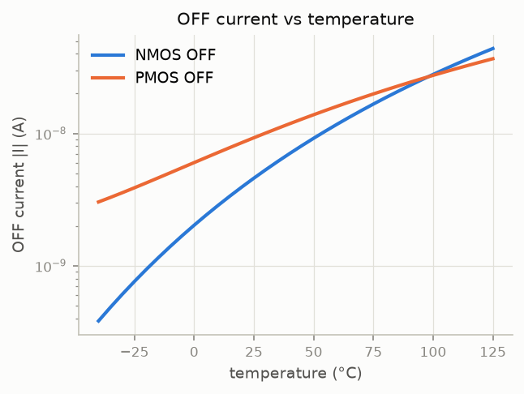
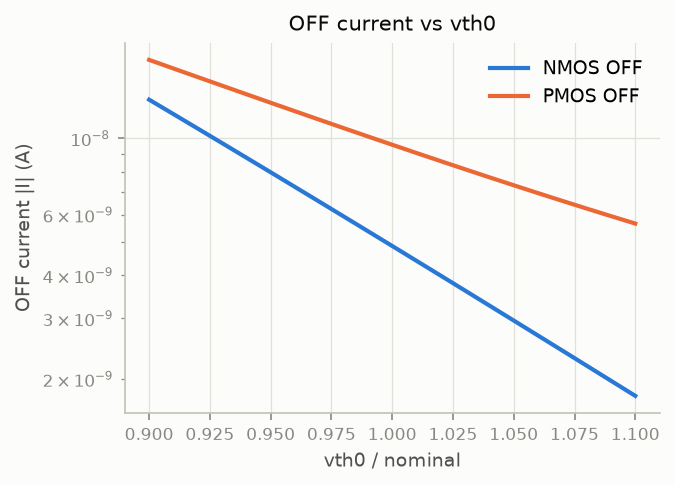
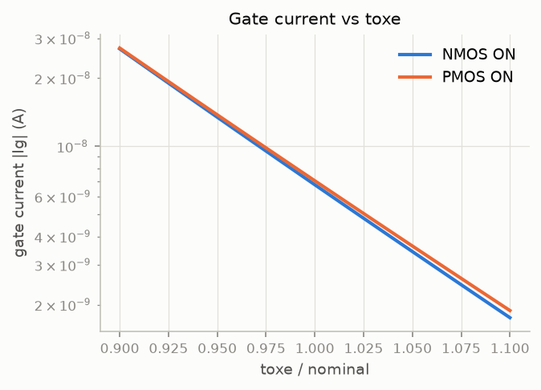
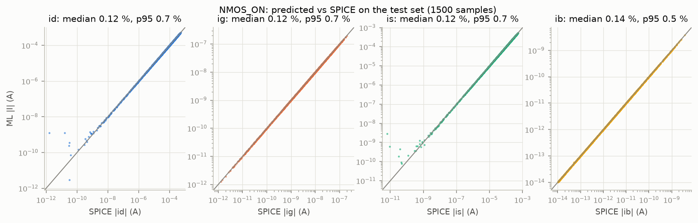
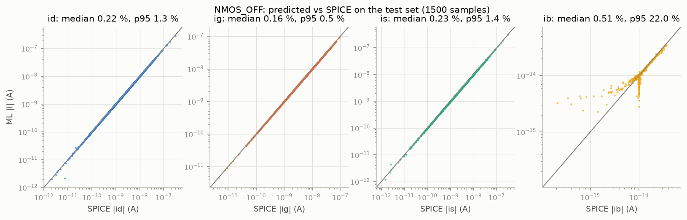
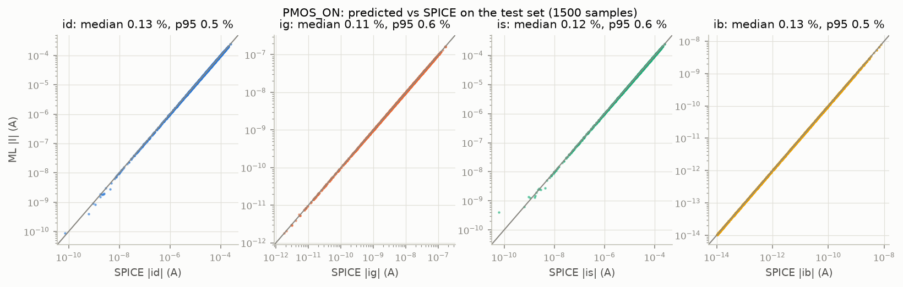
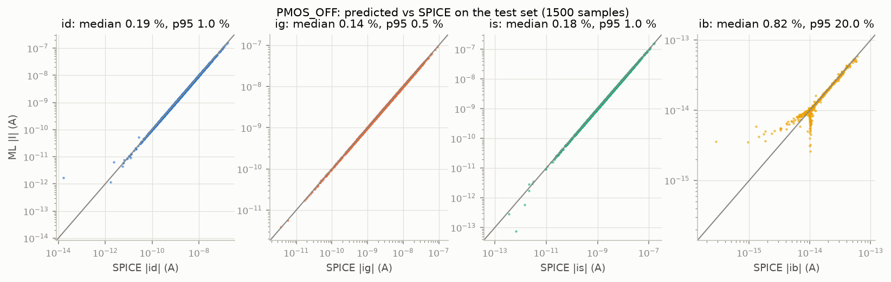
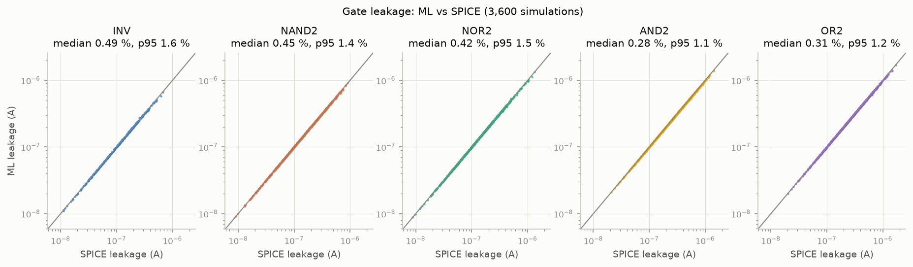
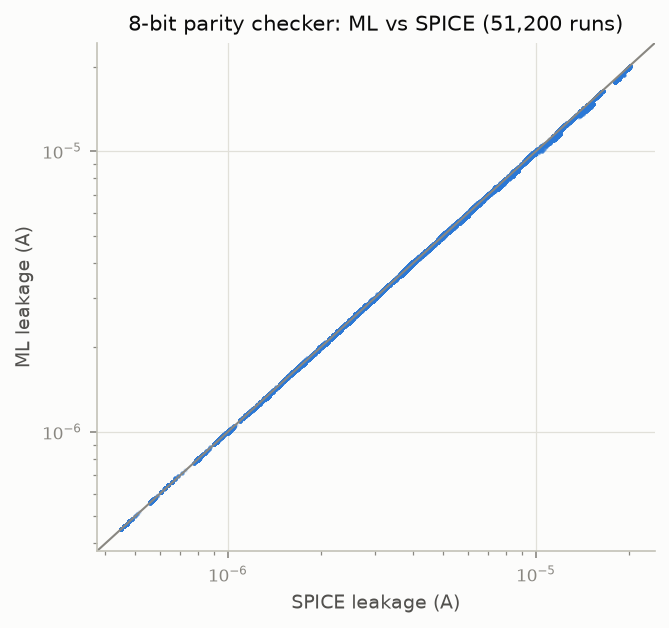
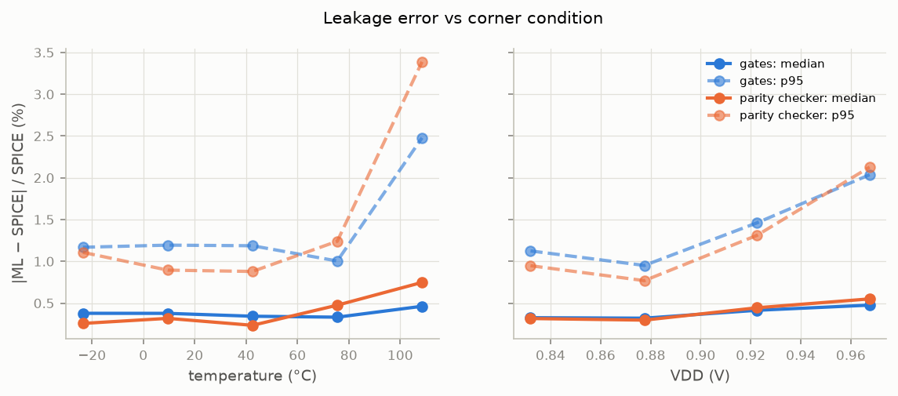

# ML-Driven PVT-Variation-Aware Leakage Estimation

**Digital VLSI Design project, IIIT Hyderabad. Team 22 (Madhurbala_riders):** Aryan Agrawal, Manikya Pant, Vansh Jaiswal, Saarthak Sabharwal.

**Summary.**
- **Part A.** We trained transistor-level ML models of the four terminal currents of the 45nm_MGK device under PVT variation: the doc's 4 × 10,000-sample datasets (split 70/15/15), with the training part enlarged by 80,000 extra simulated samples per case of the same distribution. The chosen models (averages of 3-MLP ensembles, selected on validation) reach 0.12–0.23 % median and 0.53–3.2 % p95 test error.
- **Part B.** Using only those models and the SPICE node voltages, we estimate the leakage of INV, NAND2, NOR2, AND2 and OR2 for every input combination at 200 random corners (VDD, temperature, process and widths): **0.51 % mean error (99.49 % mean accuracy)**, 0.37 % median, 1.33 % p95.
- **Part C.** The 8-bit parity checker's leakage, as the plain sum of its 28 NAND2 gate-model leakages (the doc's recipe), against a full 112-transistor SPICE simulation (51,200 runs): **0.51 % mean error (99.49 % mean accuracy)**, 0.38 % median, 1.35 % p95.
- Leakage is the total current drawn from VDD-level sources (VDD supply + inputs held at VDD); about two thirds of it is gate tunnelling. With this definition the circuit leakage equals the sum of its gate leakages to 0.18 % (section 5).
- On newly drawn corners that influenced nothing, the gates give 0.50 % and the parity checker 0.52 % mean error.

All results regenerate from the scripts in `scripts/` with fixed seeds.

## 1. Setup

| Item | Value |
|---|---|
| Model file | `45nm_MGK.pm` (PTM, BSIM4 level 54, version 4.0), from the course `model.tar` |
| Nominal VDD | 0.9 V |
| Channel length | L = 45 nm (feature size) |
| Widths | 1–8 × Lmin = 45–360 nm (transistor data, and the gate and circuit sizing) |
| Test circuit | 8-bit parity checker |
| Simulator | ngspice-42, batch mode, DC operating point (`op`) |
| Simulator options | `.options gmin=1e-18 abstol=1e-18 reltol=1e-6 vntol=1e-9` in every netlist |
| ML stack | Python 3.12, scikit-learn 1.9.1, LightGBM 4.7.0, NumPy 2.5.4, SciPy 1.18.1, pandas 3.0.6 |

The driver was first checked against the professor's sample netlist `22n_NMOS_ON.net`. It reproduces all 48 points to within 4e-5 relative difference (`scripts/verify_sim.py`).

**Choices where the doc leaves room** (discussed with the TAs):
- **Leakage of a gate or circuit** = all current drawn from VDD-level sources: the VDD supply current plus the current drawn by the inputs held at VDD. Equivalently, the static power divided by VDD. The TAs left it to us to work out which currents count; section 4 shows what this leakage consists of and why the narrower "VDD pin only" definition does not compose into a circuit.
- **Gate and circuit sizing:** L is fixed at 45 nm and the widths vary between 1 and 8 × Lmin (as the TAs advised). Each corner draws one NMOS width Wn and one PMOS width Wp, uniform in 45–360 nm, shared by every NMOS and every PMOS of the gate or circuit at that corner.
- **XOR2 for the parity checker** = the standard four-NAND2 circuit, since XOR is not one of the five gates (confirmed by the TAs).
- **Accuracy target:** "≥ 99 % accuracy" is read as a mean per-sample error below 1 % (confirmed by the TAs). We apply it to the leakage estimates (gates and test circuit); for the transistor models we report median, p95 and mean per current (still to be confirmed with the TAs).
- **Training-set size:** the doc's 10,000-row datasets are delivered and provide all validation and test rows; the final models also train on extra samples drawn the same way (section 3; still to be confirmed with the TAs). The data-size study shows what the doc's 7,000 training rows alone give.

**Metrics** used throughout: per-sample relative error |ML − SPICE| / |SPICE|, summarised by its median, its 95th percentile (p95: 95 % of samples are at or below it) and its mean; "mean accuracy" = 100 % − mean error.

## 2. Data generation

**Sampling** (doc section 4, `sim/spec.py`, `scripts/a1_generate_data.py`). For each case, 10,000 samples are drawn independently and uniformly, with a fixed seed per case:
- VDD in 0.81–0.99 V, drawn first;
- Vd and Vs each in 0–VDD;
- W in 45–360 nm;
- T in −40 to 125 °C;
- `vth0`, `toxe`, `ndep`, `u0` and `xj` each at nominal ± 10 % of the 45nm_MGK card value. NMOS and PMOS are drawn separately.

The gate and body voltages are fixed by the case: NMOS ON (VDD, 0), NMOS OFF (0, 0), PMOS ON (0, VDD), PMOS OFF (VDD, VDD).

**Netlists** (`sim/runner.py`). Each sample is one netlist:
- the model card is written inline with the sample's process values;
- one MOSFET has L = 45 nm and the sampled W;
- each of the four terminals has its own voltage source;
- the doc's `.options` line is included;
- `.options temp` is set to the sampled temperature.

The terminal currents are ngspice `i(Vd)`, `i(Vg)`, `i(Vs)`, `i(Vb)`, positive when current flows out of the device terminal. The four datasets, `data/partA/<CASE>.csv`, have exactly the doc's columns. The 4 × 10,000 doc samples take about 20 s to simulate on 16 cores.

**Split.** Each dataset is split 70 / 15 / 15 % (7,000 / 1,500 / 1,500 rows) by a random permutation with seed 22 (`ml/data.split_index`). For the final models the training part is enlarged with up to 80,000 extra samples per case, drawn the same way with other seeds (`a1_generate_data.py --extra 8`, `data/partA_extra/`); validation and test always stay the doc's 1,500 + 1,500 rows (data-size study in section 3). The test rows are never used to choose or tune a model: they score the chosen models (section 3) and feed the error analysis (section 6).

**Data check** (`reports/partA/DATA_CHECK.md`):
- every row has all values, and every value is inside its doc range;
- Kirchhoff's law: the four currents balance to within 1e-15 A or 0.1 % of the largest current in every row (median residual about 7e-7 of the largest current). The residual comes from ngspice printing 6–7 significant digits and from the solver tolerances;
- trend plots, sweeping one parameter at a time from the nominal point:
  - OFF current rises with temperature: ×115 (NMOS) and ×12 (PMOS) over −40 to 125 °C;
  - OFF current falls as |vth0| rises: ×0.14 and ×0.33 over ±10 %;
  - gate current falls as toxe rises: ×0.07 over ±10 %;
- the same trends appear in the random dataset itself as rank correlations.

  

*Figure 1. Trend checks, one parameter swept from the nominal point (W = Lmin, VDD = 0.9 V, 27 °C, nominal process). OFF current: Vd = VDD, Vs = 0 (NMOS) or Vd = 0, Vs = VDD (PMOS), current at the low-voltage terminal. Gate current: ON devices at Vd = Vs = 0 (NMOS) or VDD (PMOS).*

**Observed structure that shaped the models:**
1. The device is drain/source symmetric: swapping Vd and Vs swaps id and is (`verify_sim.py` checks it at one ON bias point, where the two agree to all 7 printed digits).
2. Rewrite each sample in terms of the higher-voltage ("hi") and lower-voltage ("lo") terminal. Then three of the four currents of every case keep one sign over the whole dataset (the only exceptions: 7 of 10,000 NMOS ON rows where Vd ≈ Vs).
3. The exception is one terminal per OFF case: lo for NMOS OFF, hi for PMOS OFF. Its outgoing channel current and its incoming gate-tunnelling current can cancel, so its sign varies. In 8.0 % (NMOS) and 4.8 % (PMOS) of OFF rows it is below 3 % of the gate current.
4. The OFF body current is about 1e-14 A, and 60–63 % of the rows lie within 1 % of 1.000e-14 A. It is 6–8 decades below the logic-gate leakages (8.8e-9 to 1.7e-6 A).

## 3. Models

**Preprocessing** (`ml/data.py`):
- **Drain/source canonical form.** Each sample is rewritten in terms of the higher-voltage ("hi") and lower-voltage ("lo") terminal; predictions are mapped back to id and is.
- **Inputs (17):** T and 1/T; VDD; W/L and its logarithm; V_hi, V_lo, V_hi − V_lo and its log10; Vg − V_hi, Vg − V_lo, Vb − V_lo; the five process deviations from nominal. All standardised.
- **Targets:** asinh(I / I0) for each of the four currents in hi/lo form, standardised. By default the currents are first divided by W/L ("per-width targets"), since leakage scales almost linearly with width; one ensemble variant learns the plain currents instead (see Ensembles below).
  - Fixed-sign currents use I0 = 1e-3 × the median |I| of the training set, which makes the target log-current, where relative error is what matters.
  - The mixed-sign OFF terminal uses I0 = 0.1 × |ig| of the same sample (at prediction time, the model's own gate-current prediction). The current it cancels against sets the scale, so its zero crossing becomes a gentle slope (validation study: `data/partA_results/mixed_scale_study.csv`, see section 6).
- One regressor per current; a saved case model (`trained_models/<CASE>.joblib`) bundles the regressors with their transforms and maps the doc's input columns to (id, ig, is, ib).

**Model types and main hyperparameters** (`ml/models.py`):
1. **Polynomial:** degree-3 polynomial features + ridge regression (α = 1e-4).
2. **LightGBM:** 4,000 trees, learning rate 0.03, 63 leaves, minimum 10 rows per leaf, row and column subsampling 0.8.
3. **MLP:** 3 hidden layers × 128 tanh units, Adam, learning rate 2e-3, L2 penalty 1e-6, early stopping on an internal 10 % of the training rows (patience 200 epochs).
4. **Gaussian process:** ARD RBF kernel (one length scale per input) × constant + white noise; kernel hyperparameters fitted on 1,000 training rows, then the posterior conditioned on all training rows.

The full tables are in `reports/partA/MODELS.md`. Validation set, 7,000 training rows (the doc's training split), errors pooled over the four currents:

| case | metric | polynomial | LightGBM | MLP | Gaussian process |
|---|---|---|---|---|---|
| NMOS ON | R² (worst current) | 0.9840 | 0.9979 | 0.9995 | 0.9989 |
| | median / p95 error | 8.72 / 56.7 % | 3.16 / 26.8 % | **0.43 / 2.58 %** | 0.11 / 3.99 % |
| NMOS OFF | R² (worst current) | 0.920 | 0.923 | 0.898 | 0.902 |
| | median / p95 error | 7.98 / 84.5 % | 2.31 / 31.2 % | **1.06 / 10.5 %** | 0.53 / 15.8 % |
| PMOS ON | R² (worst current) | 0.9891 | 0.9982 | 0.9999 | 0.9986 |
| | median / p95 error | 5.51 / 29.5 % | 2.53 / 19.2 % | 0.41 / 2.13 % | **0.07 / 1.47 %** |
| PMOS OFF | R² (worst current) | 0.875 | 0.891 | 0.853 | 0.905 |
| | median / p95 error | 8.81 / 86.3 % | 2.26 / 29.9 % | **1.04 / 8.45 %** | 0.29 / 10.7 % |

Bold = lowest p95 per case. The lower worst-current R² in the OFF cases comes from the body current: it is ~1e-14 A and nearly constant (60–63 % of rows within 1 % of 1.000e-14 A), so R² of this near-constant target says little. The other three OFF currents have R² ≥ 0.9996 for the MLP. R² is computed on the transformed target (asinh; log-current for the fixed-sign currents; see Preprocessing), where it is meaningful across decades.

**Observations:**
- The polynomial is too stiff for 17 inputs and 7–10 decades of current.
- The trees predict in steps, which suits classification but not a smooth function that has to be within 1 %.
- The Gaussian process has the best median in every case: it interpolates the smooth bulk almost exactly. Its tail is heavy, though. Near the zero crossing of the mixed-sign OFF terminal and for the body current, one smooth kernel cannot follow the steep regions, and it extrapolates poorly at the edges of the input box (section 7).
- The MLP has the best p95 in three of the four cases. For PMOS ON the Gaussian process has the lower p95 (1.47 % vs 2.13 %); the larger-data MLPs and the ensembles below beat both.

**Choice rule:** lowest validation p95, then lowest median, among all candidates (the four types at 7,000 rows, the larger-data MLPs, the ensembles and their averages). The doc reserves the gate and circuit results for evaluation, so no gate or circuit result is used to train or to select a model (see "How the gate results were used" in section 4). In the OFF cases the pooled p95 is dominated by the ~1e-14 A body current; ranking the candidates by the p95 of id, ig and is only gives the same choice in all four cases.

**Data size.** The doc asks for high accuracy with as small a dataset as possible, so we retrained the MLP with extra 10,000-row blocks. These have the same distribution with other seeds (`data/partA_extra/`), and validation/test always stay on the doc's dataset. Validation median / p95:

| case | 2,000 rows | 4,000 rows | 7,000 rows | 27,000 rows | 47,000 rows |
|---|---|---|---|---|---|
| NMOS ON | 0.75 / 7.56 % | 0.67 / 4.49 % | 0.43 / 2.58 % | 0.31 / 1.38 % | 0.32 / 1.47 % |
| NMOS OFF | 1.44 / 16.7 % | 0.81 / 10.4 % | 1.06 / 10.5 % | 0.71 / 6.96 % | 0.71 / 7.66 % |
| PMOS ON | 1.00 / 7.60 % | 0.46 / 2.51 % | 0.41 / 2.13 % | 0.34 / 1.42 % | 0.32 / 1.29 % |
| PMOS OFF | 1.19 / 14.9 % | 0.68 / 10.1 % | 1.04 / 8.45 % | 0.58 / 8.14 % | 0.64 / 7.36 % |

Below 7,000 rows (the first rows of the doc's training split): at 4,000 rows the OFF cases are about as good as at 7,000, while the ON-case p95 grows (NMOS ON 2.58 → 4.49 %); at 2,000 rows every case is clearly worse (p95 7.6–17 %). Above 7,000 rows the tail improves up to 27,000 rows, after which a single network levels off: its remaining error is mostly run-to-run variance, which the ensembles below remove. More data costs little simulation (about 20 s for 40,000 samples on 16 cores) but longer training: 1–2.4 h per case for one 87,000-row ensemble (with several trainings sharing 16 cores), against 4–8 minutes for one network on 7,000 rows.

**Ensembles.** A single network's error at the sparsely sampled corners varies from one training run to the next, so validation and gate rankings of single networks need not agree (`reports/partB/GATES_DIAGNOSTICS.md`). Averaging three MLPs trained with different seeds (on the asinh target, i.e. a geometric mean of the currents) removes most of that variance. At 47,000 rows it improves the validation median / p95 from 0.32 / 1.47 to 0.21 / 1.00 % (NMOS ON), 0.71 / 7.66 to 0.41 / 4.80 % (NMOS OFF), 0.32 / 1.29 to 0.19 / 0.85 % (PMOS ON) and 0.64 / 7.36 to 0.41 / 5.18 % (PMOS OFF).

We trained three ensemble variants on 87,000 rows, which differ in what the networks learn:
- **per-width targets** (the default above): current / (W/L);
- **plain-current targets**: the current itself;
- **linear baseline** (per-width targets): a ridge regression (α = 1e-3) on the 17 standardised features first, with the three networks learning only what it leaves. Log-current is close to linear in most inputs (1/T, vth0, toxe, VDD, log W), and the linear part carries those trends into the corners of the input box, where training rows are sparse and tanh networks flatten out.

Their errors are partly independent, so we also scored the equal-weight average of the predicted currents of two or all three variants (all four averages are in `reports/partA/MODELS.md`; the two best are shown). Validation median / p95 (87,000 training rows):

| candidate | NMOS ON | NMOS OFF | PMOS ON | PMOS OFF |
|---|---|---|---|---|
| ensemble, per-width targets | 0.18 / 0.87 % | 0.44 / 4.96 % | 0.18 / 0.71 % | 0.38 / 4.59 % |
| ensemble, plain-current targets | 0.20 / 0.92 % | 0.30 / 4.02 % | 0.20 / 0.80 % | 0.40 / 4.49 % |
| ensemble, linear baseline | 0.18 / 0.91 % | 0.31 / 3.52 % | 0.18 / 0.87 % | 0.29 / 4.44 % |
| average of plain-current + linear baseline | 0.15 / 0.68 % | **0.24 / 3.05 %** | 0.14 / 0.62 % | 0.25 / 3.48 % |
| average of all three | **0.13 / 0.60 %** | 0.23 / 3.22 % | **0.12 / 0.52 %** | **0.22 / 3.40 %** |

The selection rule picks the average of all three for NMOS ON, PMOS ON and PMOS OFF, and the average of the plain-current and linear-baseline ensembles for NMOS OFF (bold).

**Chosen models on the test set:**

| case | test median | test p95 | test mean | test mean, currents ≥ 1e-11 A | per current, median / p95 (id, ig, is, ib) |
|---|---|---|---|---|---|
| NMOS ON | **0.13 %** | **0.61 %** | 24.1 % | 3.03 % | 0.12/0.7, 0.12/0.7, 0.12/0.7, 0.14/0.5 % |
| NMOS OFF | **0.23 %** | **3.16 %** | 2.15 % | 0.36 % | 0.22/1.3, 0.16/0.5, 0.23/1.4, 0.51/22.0 % |
| PMOS ON | **0.12 %** | **0.53 %** | 0.40 % | 0.43 % | 0.13/0.5, 0.11/0.6, 0.12/0.6, 0.13/0.5 % |
| PMOS OFF | **0.22 %** | **3.05 %** | 3.28 % | 0.29 % | 0.19/1.0, 0.14/0.5, 0.18/1.0, 0.82/20.0 % |

- Test and validation agree closely (median within 0.01 %), so there is no sign of over-fitting to the validation split.
- In the OFF cases the pooled p95 comes almost entirely from the ~1e-14 A body current. Without it, the three currents that matter have p95 ≤ 1.4 %.
- The means are pulled up by a few near-zero currents, where relative error is large but absolute error negligible: the ~1e-14 A OFF body current, and ON-device terminal currents that cross zero near Vd = Vs (e.g. |id| = 1.6e-12 A against ~1e-4 A at full bias, where the error is 78,000 %; the absolute error is 1e-9 A). Leaving out currents below 1e-11 A (1,000× below the smallest gate leakage, 8.8e-9 A) brings the OFF and PMOS ON means to 0.29–0.43 %. NMOS ON stays at 3.0 % from ON channel currents near their zero crossing, which never enter the gate leakage (section 4: inside the cut only the gate and body currents of ON devices are used).
- The predicted-vs-SPICE plots for the test set are in Figure 2.

*Figure 2. Chosen models on the test set (1,500 samples per case): predicted vs SPICE |I| for each terminal current.*

## 4. Gate results

**Gates** (`sim/gates.py`, `scripts/b1_gates_spice.py`):
- standard static CMOS; AND2/OR2 = NAND2/NOR2 + INV, simulated as complete gates;
- 200 corners (seed 2200), each with its own VDD, T, NMOS process draw, PMOS process draw, and widths Wn and Wp (each uniform in 1–8 × Lmin, shared by all NMOS and all PMOS of the gate);
- inputs at exactly 0 or VDD, each from its own voltage source;
- node voltages are printed with 12 digits, because output-high nodes sit only 13 µV–18 mV below VDD.

**What is leakage?** In a static gate no current should flow, so every current SPICE reports is leakage. It leaves the circuit through the ground pin and the inputs held at 0, and enters through the VDD pin and the inputs held at VDD. We define the leakage as the total current drawn from VDD-level sources: the VDD supply current plus the current drawn by the inputs held at VDD, i.e. the static power / VDD. The VDD pin alone is not enough: a gate whose inputs are high draws much of its leakage (gate tunnelling into the ON NMOS channels) through those inputs, and inside a circuit that current comes from the driving gate's VDD pin. Section 5 shows the consequence: with this definition the circuit leakage is the plain sum of its gate leakages (0.18 % median difference in SPICE), with the VDD-pin current alone the same sum is 24 % off.

To see which currents make it up, every gate simulation was repeated with the model's gate tunnelling switched off (BSIM4 `igcmod = igbmod = 0`; `scripts/b3_leakage_components.py`, full table in `reports/partB/LEAKAGE_COMPONENTS.md`). What remains is sub-threshold channel current plus junction current:

| gate | inputs | SPICE leakage, median (A) | gate tunnelling | sub-threshold + junction | drawn through inputs at VDD |
|---|---|---|---|---|---|
| INV | 0 / 1 | 1.10e-07 / 1.13e-07 | 65 / 46 % | 35 / 54 % | 0 / 46 % |
| NAND2 | 00 / 11 | 1.01e-07 / 2.26e-07 | 97 / 46 % | 3 / 54 % | 0 / 46 % |
| NOR2 | 00 / 11 | 2.19e-07 / 8.97e-08 | 64 / 92 % | 36 / 8 % | 0 / 92 % |
| all 18 cases × 200 corners | | | 67 % (median; 17–98 % for 90 % of runs) | 33 % | |

With the 0.9 nm oxide of this model card, gate tunnelling is the larger part in 66 % of the runs. Sub-threshold current grows with temperature and takes over when hot: the tunnelling share falls from 89 % (median, below 0 °C) to 34 % (above 85 °C), and from 73 % to 52 % going from the highest to the lowest NMOS vth0 quarter. Both mechanisms are in the transistor models, so the ML gate leakage covers both.

**ML gate leakage** (`ml/gate_eval.py`):
1. Each transistor's terminal voltages come from the SPICE-recorded output and internal nodes, with exact inputs and rails.
2. Its case (ON/OFF) follows from its gate voltage.
3. The matching model predicts its four currents.
4. The currents are combined into the VDD current by Kirchhoff's law over a **cut through the OFF devices** instead of at the vdd node:
   - Summing at the vdd node needs the channel current of ON pull-up devices, which sit at microvolt Vds. There the channel current is a tiny difference set by the OFF network, and the training data has almost no rows. Even with the final models the vdd-node sum gives 2.4 % median, 5.2 % mean and up to 70 % error in a single run (table below); with the 7,000-row MLP it is 14 % median and with the Gaussian process 137 % (`reports/partB/GATES_DIAGNOSTICS.md`).
   - Any node set S that contains vdd but not ground or an input gives an exact formula: I_leak = −Σ terminal currents at nodes in S. For a device with both drain and source in S, id + is is replaced by −(ig + ib), so its channel current cancels exactly.
   - We pick the S whose cut devices are all OFF with the largest smallest |Vds|.
5. The current drawn by each input held at VDD is the sum of the gate currents of the transistors that input drives (from the same model predictions); it is added to the VDD current from step 4.

With each transistor simulated alone in SPICE instead of the ML model, this recipe reproduces the full-gate SPICE leakage to within 0.0005 % (median 0.00004 %, max 0.00042 %; "device-SPICE" check). So the recipe is exact, and the remaining error belongs to the models.

**Results** (`reports/partB/GATES.md`; parity plot in Figure 3):

| gate | inputs | SPICE median (A) | ML median (A) | bias | median error | p95 error |
|---|---|---|---|---|---|---|
| INV | 0 | 1.098e-07 | 1.097e-07 | +0.26 % | 0.50 % | 1.66 % |
| INV | 1 | 1.129e-07 | 1.125e-07 | −0.28 % | 0.48 % | 1.35 % |
| NAND2 | 00 | 1.008e-07 | 1.016e-07 | +0.53 % | 0.57 % | 1.43 % |
| NAND2 | 01 | 1.579e-07 | 1.586e-07 | +0.10 % | 0.34 % | 1.18 % |
| NAND2 | 10 | 9.068e-08 | 9.085e-08 | +0.29 % | 0.44 % | 1.47 % |
| NAND2 | 11 | 2.256e-07 | 2.250e-07 | −0.23 % | 0.43 % | 1.35 % |
| NOR2 | 00 | 2.189e-07 | 2.188e-07 | +0.27 % | 0.48 % | 1.54 % |
| NOR2 | 01 | 1.668e-07 | 1.664e-07 | +0.06 % | 0.29 % | 1.38 % |
| NOR2 | 10 | 9.702e-08 | 9.693e-08 | −0.21 % | 0.43 % | 1.55 % |
| NOR2 | 11 | 8.966e-08 | 8.930e-08 | −0.33 % | 0.48 % | 1.43 % |
| AND2 | 00 | 2.420e-07 | 2.419e-07 | +0.13 % | 0.30 % | 1.10 % |
| AND2 | 01 | 2.823e-07 | 2.823e-07 | −0.17 % | 0.30 % | 1.16 % |
| AND2 | 10 | 2.128e-07 | 2.127e-07 | −0.12 % | 0.27 % | 1.18 % |
| AND2 | 11 | 3.466e-07 | 3.457e-07 | −0.12 % | 0.28 % | 1.01 % |
| OR2 | 00 | 3.478e-07 | 3.475e-07 | −0.21 % | 0.38 % | 1.27 % |
| OR2 | 01 | 2.875e-07 | 2.874e-07 | +0.12 % | 0.32 % | 1.05 % |
| OR2 | 10 | 2.230e-07 | 2.233e-07 | +0.00 % | 0.28 % | 1.01 % |
| OR2 | 11 | 2.299e-07 | 2.296e-07 | −0.02 % | 0.28 % | 1.33 % |

**All 3,600 gate simulations:** median error 0.37 %, p95 1.33 %, **mean 0.51 % (99.49 % mean accuracy)**. 89 % of the simulations are within 1 %; the largest single error is 6.9 %. The VDD supply current alone (without the input currents) is predicted to 0.43 % median and 0.57 % mean error.

*Figure 3. Gate leakage, ML vs SPICE, all 3,600 gate simulations (log axes), one panel per gate (all input combinations and corners).*

**How the currents are combined matters more than the model:**

| method | median | p95 | mean |
|---|---|---|---|
| sum at the vdd node | 2.43 % | 18.2 % | 5.17 % |
| minimal supernode (vdd + ON-connected nodes) | 0.38 % | 1.37 % | 0.52 % |
| **best cut through the OFF devices (used)** | **0.37 %** | **1.33 %** | **0.51 %** |

With weaker models the vdd-node sum is far worse: 14 % median with the 7,000-row MLP, 84 % with LightGBM and 137 % with the Gaussian process (`reports/partB/GATES_DIAGNOSTICS.md`). The difference is the ON-device channel currents at microvolt Vds, which cancel exactly in the cut-based sum.

**How the gate results were used.** No gate or circuit SPICE result is used to train a model or to choose between models; selection is on the Part A validation set only. The gate runs and an earlier fresh-data check did inform the method, and we state where:
- the cut-based sum was developed after early gate runs showed the vdd-node sum failing;
- the ensemble candidate was added after gate runs showed single networks of different training sizes ranking differently from their validation scores;
- the per-width, plain-current and linear-baseline variants, the 87,000-row training size and the averaging of variants were all tried after the gate runs and the earlier fresh-data check showed the largest errors at hot, low-vth0 or thin-oxide, high-VDD corners with wide devices, where the current exceeds anything in the training data and the networks flatten out (section 6). An informal check (single 7,000-row networks on newly simulated transistor samples from those corners; not part of the scripts) pointed to the linear baseline. The choice among all candidates was then made on validation only, but because the gate results shaped which candidates exist, the gate numbers are slightly optimistic; the fresh-data check below is the independent evidence;
- the edge-sample experiment was also run at gate level, although validation alone already rejects it (section 7).

To check that the gate and circuit numbers hold on data that influenced nothing, `scripts/d3_fresh_check.py` draws new transistor samples and 100 new corners with seeds drawn after all the method changes above (`reports/FRESH_CHECK.md`). The gates give 0.37 % median, 1.39 % p95 and 0.50 % mean error; the parity checker on those 100 corners × 256 vectors gives 0.41 % median, 1.47 % p95 and 0.52 % mean; new transistor samples match the test-set medians to within 0.01 %. So the reported accuracy is not an artefact of the data that guided the method.

**Most and least accurate.**
- **Most accurate: the two-stage gates AND2 and OR2** (0.27–0.38 % median in every input case; among the single-stage gates only NOR2 01 and NAND2 01 come close, 0.29 and 0.34 %). Their leakage is the sum of two stages whose device errors partly offset.
- **Least accurate: the output-high single-stage cases NAND2 00 (0.57 %) and INV 0 (0.50 %)**, which also have a positive bias (+0.53 and +0.26 %, like the other output-high cases NAND2 10 and NOR2 00). Their leakage flows through OFF NMOS with the drain at ~VDD (the largest Vds, an edge of the (Vd, Vs) square) and includes the gate tunnelling of the ON PMOS at Vd ≈ Vs ≈ VDD, the far corner of the training square.
- **Bias is small** (−0.33 to +0.53 %): over all output-high cases +0.14 %, over output-low cases −0.14 % (`reports/ERROR_ANALYSIS.md`). Bias here is the median over corners of ML / SPICE − 1, not the ratio of the two median columns; in most cases the error is mainly scatter.

## 5. Test-circuit results

**Circuit** (`sim/parity.py`):
- 7 XOR2 gates in a balanced tree; each XOR2 is the standard 4-NAND2 circuit (28 NAND2, 112 transistors);
- XOR is not one of the five gates, so the ML side composes it from the NAND2 gate model;
- SPICE runs the full netlist for all 256 vectors at the same 200 corners: 51,200 runs, about 4.5 minutes.

**ML** (`scripts/c2_parity_ml.py`): for each vector, find every NAND2's input pattern and look up the NAND2 gate-model leakage of section 4 at that corner (same widths and process); the circuit leakage is the sum of the 28, as the doc prescribes.

**Why the plain sum works with our leakage definition.** Inside the circuit, the current an internal input at logic 1 draws comes from the VDD pin of the gate driving it. A stand-alone gate's VDD-pin current does not include it, but its "drawn through inputs at VDD" part does, so each such current is counted exactly once, in the receiving gate. Composing SPICE gate values (stand-alone SPICE NAND2 leakages summed the same way) against the full netlist isolates this composition step from the ML error:

| sum of stand-alone SPICE NAND2 leakages vs full-netlist SPICE | median | p95 | max |
|---|---|---|---|
| **leakage = VDD supply + inputs at VDD (used)** | **0.18 %** | **0.93 %** | **2.15 %** |
| leakage = VDD supply current only | 23.9 % | 60.7 % | 76.0 % |

The 0.2 % that remains comes from internal nodes not sitting exactly at 0 or VDD (up to 18 mV away) and from the next gate's input current slightly shifting each node.

**Results** (`reports/partC/PARITY.md`; parity plot in Figure 4), all 51,200 runs:

| estimate | SPICE median (A) | ML median (A) | bias | median error | p95 error | mean error |
|---|---|---|---|---|---|---|
| **ML: sum of the 28 NAND2 gate-model leakages** | 4.761e-06 | 4.747e-06 | −0.22 % | **0.38 %** | **1.35 %** | **0.51 %** |

90 % of the runs are within 1 %; the largest single error is 4.7 %. The ML sum differs from the sum of the SPICE gate values by 0.24 % median (p95 1.03 %): that is the gate-model error, on top of the 0.18 % composition error above.

*Figure 4. 8-bit parity checker, ML vs SPICE leakage for all 51,200 runs (log axes).*

- **Accuracy is nearly flat across the input vectors** (0.34–0.41 % median for 0 to 8 inputs high), because every vector exercises the same four NAND2 patterns in different proportions.
- **Gate level vs circuit level:** the circuit's mean error (0.51 %, i.e. 99.49 % mean accuracy) and p95 (1.35 %) match the gate level (0.51 % / 1.33 %). At each corner the circuit estimate is a weighted sum of the same four NAND2 gate-model values, so it inherits their accuracy (NAND2 alone: 0.45 % median, 0.56 % mean) rather than averaging errors out, plus the small composition error. The doc expected the circuit to be "somewhat lower" in accuracy than the gates; with our leakage definition the composition step adds only 0.18 % (median), while with the VDD-pin current alone it would add 24 %.

## 6. Error analysis

Full numbers are in `reports/ERROR_ANALYSIS.md` (`scripts/d1_error_analysis.py`).

**Transistor models.** In this section a sample's error is the worst of its id, ig and is errors (ib separately), which is stricter than the pooled metric of section 3, so its p95 values are higher. The largest relative errors come from four places:

1. **Near-zero currents.** When |Vd − Vs| < 10 mV in an ON device, id and is are tiny differences that can cross zero (down to ~1e-12 A against ~1e-4 A at full bias). The p95 error there is 344 % (NMOS ON) and 24 % (PMOS ON), against 0.4 % at |Vd − Vs| > 0.5 V. The absolute error is negligible, and the channel currents (id, is) of these ON devices never enter the gate sums: inside the cut only their gate and body currents are used.
2. **The OFF body current ib** (~1e-14 A, 60–63 % of rows within 1 % of 1.000e-14 A) carries the p95 of the OFF cases: 22 % for NMOS and 20 % for PMOS, against ≤ 1.4 % for id, ig and is. It is 6–8 decades below the logic-gate leakages, so it does not affect Parts B and C.
3. **The mixed-sign OFF terminal** (lo for NMOS, hi for PMOS) is the hardest real current. Where the outgoing channel current and the incoming gate-tunnelling current cancel, relative error grows (see section 2). Scaling its target by the sample's own gate current, instead of a constant, cut this terminal's validation error from 2.84 to 0.96 % median (p95 16.4 → 7.3 %) for NMOS OFF and from 4.78 to 1.86 % (p95 29.8 → 8.1 %) for PMOS OFF (one 7,000-row MLP on plain-current targets, `scripts/a3c_mixed_scale_study.py`).
4. **Corner conditions.**
   - The median error is nearly flat across temperature, vth0 and toxe (0.20–0.25 % ON, 0.30–0.49 % OFF in every band).
   - The tail grows at the edges of the input box: NMOS ON p95 7.2 % at −40 to −7 °C against 0.7–1.0 % elsewhere, and 1.9 % at +5 to +10 % vth0; NMOS OFF p95 4.6 % at the cold end against 1.8–2.1 %; in the OFF cases the largest |Vd − Vs| band (0.5–1 V) has p95 4.2 % (NMOS) and 2.6 % (PMOS) against 1.0–1.8 % at 0.05–0.5 V, because the training data thins out towards the corners of the (Vd, Vs) square.

**Gates.**
- The error grows towards the hot and high-VDD corners: median / p95 0.46 / 2.5 % at 92–125 °C against 0.33–0.38 / 1.0–1.2 % below, and 0.48 / 2.0 % at 0.945–0.99 V against 0.32–0.33 / 1.0–1.1 % below 0.9 V. It is also higher for the lowest NMOS vth0 band (−10 to −5 %: 0.50 %) and for narrow PMOS (45–124 nm: 0.44 / 2.1 % against 0.31 / 1.0 % for the widest).
- These are the conditions that make the leakage largest or put a device at the edge of its training range. The worst corners combine several of them: corner 168 (VDD 0.99 V, NMOS toxe −9.6 %, Wn = 306 nm) and corner 173 (124 °C, NMOS vth0 −8 %) reach 6.9 % and 6.2 % in single gate cases. Only 0.33 % of the gate simulations exceed 5 %.
- At these corners the OFF drain current exceeds every current in the training data, and a tanh network flattens out (in an informal check at a corner of this kind, 124 °C with NMOS vth0 −9 % and W = 311 nm, the 87,000-row plain-current ensemble predicted the OFF drain current 29 % too low while the source current, learned on the gate-current scale, stayed within about 2 %). The linear baseline carries the trends into these corners: alone, its largest gate error is 4.7 % against 21 % (per-width) and 14 % (plain-current) for the other single ensembles (`reports/partB/GATES_DIAGNOSTICS.md`). The chosen averages, picked on validation, land in between (6.9 %).

**Parity checker.** It follows the same trends: median / p95 0.23–0.48 / 0.9–1.2 % up to 92 °C against 0.75 / 3.4 % at 92–125 °C, and 0.30–0.32 % below 0.9 V against 0.44–0.55 % above. Its leakage is a sum of the same NAND2 cases, and at high temperature the OFF-device currents, the less accurate ones, dominate the sum.

*Figure 5. Median and p95 leakage error vs temperature and VDD, for the gates and the parity checker.*

## 7. Limitations and improvements

- **Sampling vs use.**
  - Gates bias their transistors at the edges of the (Vd, Vs) square (terminals at a rail, ON devices at microvolt Vds), but uniform sampling covers these points thinly.
  - We tested adding 10,000 training-only rows concentrated there (`scripts/a1b_edge_data.py`). It made things **worse**: validation went from 1.04–1.06 % to 2.4–2.8 % median in the OFF cases (p95 8.5–10.5 → 27–41 %), and the gate error rose from 1.88 % to 2.14 % median (mean 2.75 → 3.26 %). The edge rows did teach the ON-device currents at microvolt Vds (the vdd-node sum improved from 14 % to 1.3 % median), but at the expense of the OFF-device currents the cut relies on. We kept the doc's uniform sampling and added more uniform data instead.
  - A model with explicit physical structure in Vds, e.g. I_channel ∝ (1 − exp(−Vds/vt)), would handle the edges better.
- **ON devices at microvolt Vds.**
  - The models resolve the channel current there only poorly (the uniformly sampled data has few such rows), which is why the vdd-node sum is still 2.4 % median and why the cut-based sum avoids needing that current.
  - It also limits ML's own internal-node estimate (KCL at each internal node with the ML models): it matches SPICE to a median of 0.33 mV or better in every gate case, but fails in a few corners where the balance hinges on an ON device at microvolt Vds (worst: OR2 inputs 10, node y, 0.77 V; `reports/partB/GATES.md`).
- **Composition from stand-alone gates.** Each gate is simulated with its inputs exactly at 0 or VDD, while inside the circuit they are up to 18 mV off the rails, and the next gate's input current slightly shifts each node. This leaves 0.18 % median (2.15 % max) between the sum of SPICE gate values and the full circuit (section 5).
- **Joint extremes of the input box.** Where several inputs sit at the edge of their range at once (hot + low vth0, or thin oxide + high VDD, with a wide device), the current exceeds anything in the training data and the error rises to a few % in single gate cases (section 6). The linear-baseline ensemble alone handles these corners best (largest gate error 4.7 %), but the validation rule prefers the averages, which reach 6.9 %; a selection rule that also weighs a stress set at the corners, denser sampling there, or a physically shaped model of the sub-threshold and tunnelling currents would reduce it further.
- **Model variance.** A single network's gate-level error depends on how it happens to fit the corners: the 27,000- and 47,000-row MLPs give 1.43 % and 1.24 % gate mean error, the 3-seed ensembles 0.74–1.03 %, and the chosen averages of the ensemble variants 0.51 % (`reports/partB/GATES_DIAGNOSTICS.md`).
- **Validation accuracy in the bulk does not guarantee accuracy at the edges.**
  - The Gaussian process has the best validation median in every case (0.07–0.53 %), but used in the gates it gives 12.6 % median and 18.7 % mean error, up to 42 % median for NOR2 11; its vdd-node sum is 137 % median.
  - The gate operating points sit at the edges of the training box (terminals at 0 or VDD, ON devices at Vd ≈ Vs). Away from its training points an RBF kernel falls back towards the mean, while the MLP's tanh units extend the trend. Its validation p95 (10.7–15.8 % in the OFF cases) already shows the heavy tail.
  - It illustrates why a selection rule based on the p95 (tail) error is safer than one based on the median.
- **Gate voltages slightly off the rails.** In AND2 and OR2 the INV stage's gate is the internal node n, up to about 19 mV away from 0 or VDD, while the ON/OFF models were trained with the gate exactly at 0 or VDD. The effect is small (AND2/OR2 are among the most accurate cases) but it is an extrapolation.
- **Scope.**
  - One model file, nominal VDD 0.9 V, DC leakage only.
  - Within a gate or circuit all NMOS share one width and all PMOS share another (drawn per corner). Mixed sizings within a gate need no new models, since the transistor models cover W = 1–8 × Lmin, only new SPICE references.
