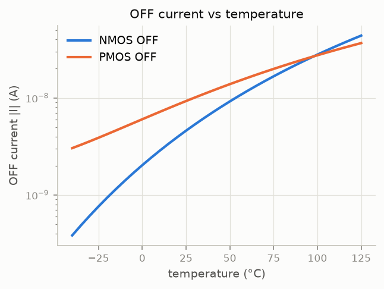
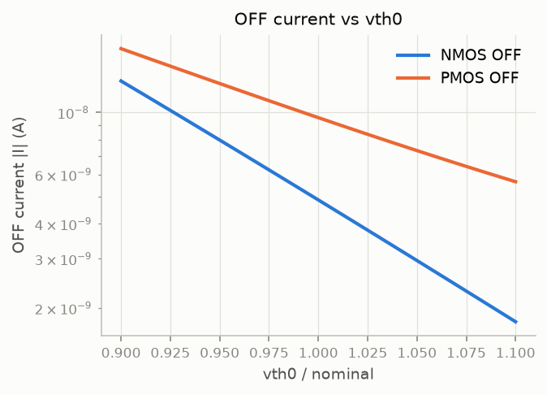
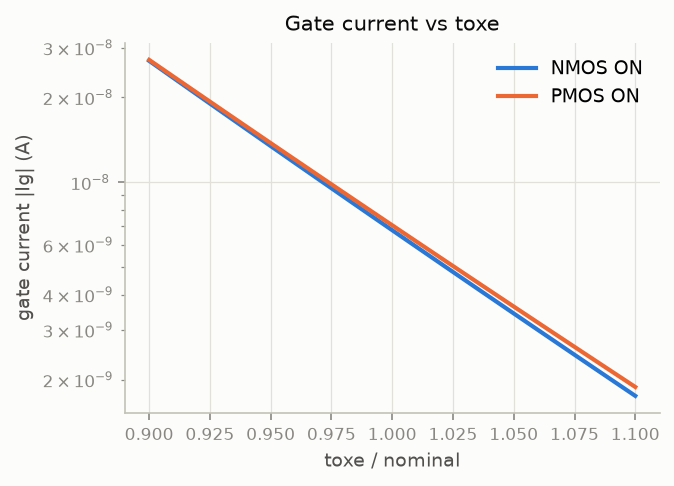

# Part A data check

Model `45nm_MGK.pm`, nominal VDD 0.9 V, L = 45 nm. Datasets: `data/partA/<CASE>.csv`, 10,000 rows each (generated by `scripts/a1_generate_data.py`).

**Result: all checks passed.**

## 1. Completeness and ranges

- ✅ NMOS_ON: 10000 rows, no missing values, every input inside its doc range
- ✅ NMOS_OFF: 10000 rows, no missing values, every input inside its doc range
- ✅ PMOS_ON: 10000 rows, no missing values, every input inside its doc range
- ✅ PMOS_OFF: 10000 rows, no missing values, every input inside its doc range

## 2. Kirchhoff check (id + ig + is + ib = 0)

| case | max \|sum\| (A) | median \|sum\| / max\|I\| | max \|sum\| / max\|I\| | rows with \|sum\| > 1e-15 A and > 1e-3·max\|I\| |
|---|---|---|---|---|
| NMOS_ON | 5.4e-10 | 7.1e-07 | 2.2e-04 | 0 |
| NMOS_OFF | 5.4e-13 | 6.3e-07 | 5.0e-06 | 0 |
| PMOS_ON | 5.5e-10 | 6.3e-07 | 5.4e-06 | 0 |
| PMOS_OFF | 5.3e-13 | 7.7e-07 | 9.4e-05 | 0 |

- ✅ NMOS_ON: every row balances to within 1e-15 A or 0.1 % of its largest current
- ✅ NMOS_OFF: every row balances to within 1e-15 A or 0.1 % of its largest current
- ✅ PMOS_ON: every row balances to within 1e-15 A or 0.1 % of its largest current
- ✅ PMOS_OFF: every row balances to within 1e-15 A or 0.1 % of its largest current

The residual comes from ngspice printing 6–7 significant digits and from the solver tolerances (abstol = 1e-18 A, reltol = 1e-6). It is far below the 1 % accuracy target.

## 3. Trend plots

| sweep | case | low end | high end | ratio |
|---|---|---|---|---|
| off_vs_temp | NMOS_OFF | 3.823e-10 A | 4.384e-08 A | ×115 |
| off_vs_temp | PMOS_OFF | 3.034e-09 A | 3.671e-08 A | ×12.1 |
| off_vs_vth0 | NMOS_OFF | 1.296e-08 A | 1.788e-09 A | ×0.138 |
| off_vs_vth0 | PMOS_OFF | 1.692e-08 A | 5.660e-09 A | ×0.335 |
| gate_vs_toxe | NMOS_ON | 2.693e-08 A | 1.751e-09 A | ×0.065 |
| gate_vs_toxe | PMOS_ON | 2.715e-08 A | 1.883e-09 A | ×0.0694 |

- ✅ NMOS_OFF: OFF current rises steadily with temperature (×115 over −40..125 °C)
- ✅ NMOS_OFF: OFF current falls as |vth0| rises (×0.14 over ±10 %)
- ✅ PMOS_OFF: OFF current rises steadily with temperature (×12 over −40..125 °C)
- ✅ PMOS_OFF: OFF current falls as |vth0| rises (×0.33 over ±10 %)
- ✅ NMOS_ON: gate current falls as toxe rises (×0.07 over ±10 %)
- ✅ PMOS_ON: gate current falls as toxe rises (×0.07 over ±10 %)

### The same trends in the random dataset

Spearman rank correlation of the current with each input, over the whole dataset (OFF cases: rows with |Vd − Vs| > 0.5·VDD, OFF current at the low-voltage terminal).

| case | current | vs temperature | vs \|vth0\| | vs toxe |
|---|---|---|---|---|
| NMOS_ON | gate current | +0.01 | -0.06 | -0.42 |
| NMOS_OFF | OFF current | +0.40 | -0.10 | -0.22 |
| PMOS_ON | gate current | +0.00 | -0.03 | -0.46 |
| PMOS_OFF | OFF current | +0.26 | -0.10 | -0.53 |

- ✅ NMOS_ON dataset: gate current falls with toxe (ρ = -0.42)
- ✅ NMOS_OFF dataset: OFF current rises with T (ρ = +0.40) and falls with |vth0| (ρ = -0.10)
- ✅ PMOS_ON dataset: gate current falls with toxe (ρ = -0.46)
- ✅ PMOS_OFF dataset: OFF current rises with T (ρ = +0.26) and falls with |vth0| (ρ = -0.10)

## 4. Example netlists

`netlists/partA/<CASE>.cir`: the first sample of each dataset, exactly as simulated (run with `ngspice -b netlists/partA/NMOS_ON.cir`).
