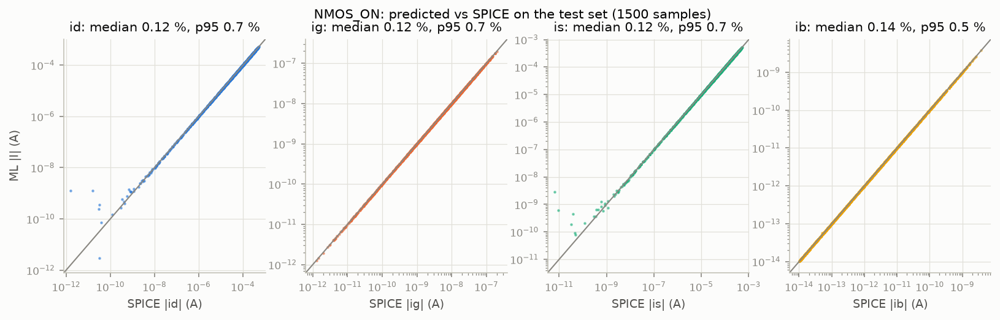
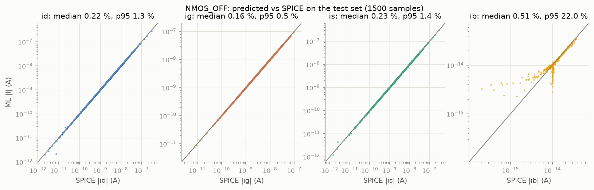
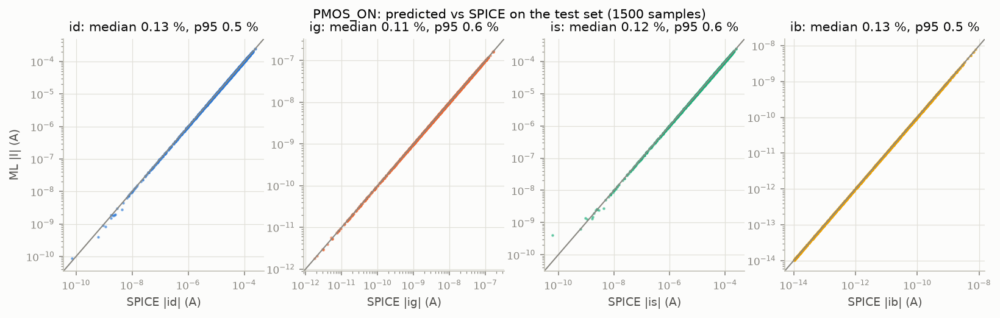
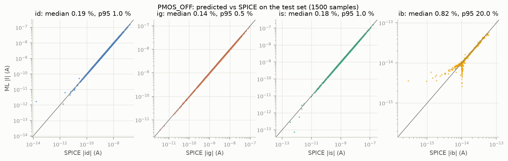

# Part A: transistor models

Split: 70 / 15 / 15 % (7,000 / 1,500 / 1,500 rows) of each 10,000-row dataset, fixed seed (`ml/data.split_index`). Errors are per-sample |ML − SPICE| / |SPICE| pooled over the four terminal currents; R² is on the transformed target (log-current, see `ml/data.py`), worst of the four currents.

## Model comparison (validation set, 7,000 training rows)

| case | metric | polynomial | LightGBM | MLP | Gaussian process |
|---|---|---|---|---|---|
| NMOS_ON | R² (worst current) | 0.9840 | 0.9979 | 0.9995 | 0.9989 |
| NMOS_ON | median error | 8.72 % | 3.16 % | 0.43 % | 0.11 % |
| NMOS_ON | p95 error | 56.65 % | 26.81 % | 2.58 % | 3.99 % |
| NMOS_OFF | R² (worst current) | 0.9200 | 0.9225 | 0.8982 | 0.9021 |
| NMOS_OFF | median error | 7.98 % | 2.31 % | 1.06 % | 0.53 % |
| NMOS_OFF | p95 error | 84.48 % | 31.22 % | 10.50 % | 15.84 % |
| PMOS_ON | R² (worst current) | 0.9891 | 0.9982 | 0.9999 | 0.9986 |
| PMOS_ON | median error | 5.51 % | 2.53 % | 0.41 % | 0.07 % |
| PMOS_ON | p95 error | 29.48 % | 19.20 % | 2.13 % | 1.47 % |
| PMOS_OFF | R² (worst current) | 0.8754 | 0.8909 | 0.8534 | 0.9047 |
| PMOS_OFF | median error | 8.81 % | 2.26 % | 1.04 % | 0.29 % |
| PMOS_OFF | p95 error | 86.28 % | 29.87 % | 8.45 % | 10.72 % |

### Per current (validation, median / p95)

| case | model | id median / p95 | ig median / p95 | is median / p95 | ib median / p95 |
|---|---|---|---|---|---|
| NMOS_ON | poly | 10.30 / 111.4 % | 8.63 / 45.4 % | 10.31 / 111.3 % | 6.79 / 28.5 % |
| NMOS_ON | lgbm | 1.89 / 34.9 % | 3.08 / 12.9 % | 1.90 / 34.7 % | 7.79 / 27.8 % |
| NMOS_ON | mlp | 0.34 / 2.2 % | 0.68 / 4.1 % | 0.35 / 2.6 % | 0.46 / 1.8 % |
| NMOS_ON | gp | 0.11 / 5.5 % | 0.06 / 6.0 % | 0.11 / 5.5 % | 0.19 / 1.7 % |
| NMOS_OFF | poly | 21.66 / 120.9 % | 1.94 / 7.9 % | 22.56 / 142.2 % | 4.93 / 25.8 % |
| NMOS_OFF | lgbm | 3.54 / 43.0 % | 2.39 / 8.9 % | 3.73 / 43.0 % | 0.62 / 25.4 % |
| NMOS_OFF | mlp | 0.85 / 4.8 % | 0.78 / 2.8 % | 0.81 / 4.7 % | 3.43 / 29.7 % |
| NMOS_OFF | gp | 0.67 / 16.6 % | 0.01 / 0.1 % | 0.74 / 18.3 % | 1.82 / 30.0 % |
| PMOS_ON | poly | 5.64 / 31.9 % | 5.74 / 39.9 % | 5.66 / 31.9 % | 5.07 / 20.5 % |
| PMOS_ON | lgbm | 1.70 / 17.8 % | 2.35 / 10.2 % | 1.66 / 17.1 % | 7.13 / 24.0 % |
| PMOS_ON | mlp | 0.31 / 1.6 % | 0.61 / 2.9 % | 0.30 / 1.5 % | 0.51 / 2.0 % |
| PMOS_ON | gp | 0.08 / 1.6 % | 0.04 / 1.7 % | 0.08 / 1.6 % | 0.11 / 1.2 % |
| PMOS_OFF | poly | 23.91 / 114.7 % | 1.96 / 8.7 % | 23.56 / 132.0 % | 5.32 / 28.6 % |
| PMOS_OFF | lgbm | 3.35 / 33.3 % | 2.24 / 7.5 % | 3.66 / 43.4 % | 0.68 / 27.5 % |
| PMOS_OFF | mlp | 0.71 / 3.6 % | 0.96 / 2.8 % | 0.71 / 4.4 % | 2.56 / 32.1 % |
| PMOS_OFF | gp | 0.35 / 9.2 % | 0.00 / 0.1 % | 0.37 / 14.9 % | 1.45 / 27.6 % |

## Data-size study (MLP, validation set)

Fewer than 7,000 rows = the first rows of the doc's (random) training split; more = that split plus extra rows from `data/partA_extra/` (same distribution, other seeds). Validation and test rows are always the doc's dataset.

| case | 2,000 rows: median / p95 | 4,000 rows: median / p95 | 7,000 rows: median / p95 | 27,000 rows: median / p95 | 47,000 rows: median / p95 |
|---|---|---|---|---|---|
| NMOS_ON | 0.75 / 7.56 % | 0.67 / 4.49 % | 0.43 / 2.58 % | 0.31 / 1.38 % | 0.32 / 1.47 % |
| NMOS_OFF | 1.44 / 16.72 % | 0.81 / 10.43 % | 1.06 / 10.50 % | 0.71 / 6.96 % | 0.71 / 7.66 % |
| PMOS_ON | 1.00 / 7.60 % | 0.46 / 2.51 % | 0.41 / 2.13 % | 0.34 / 1.42 % | 0.32 / 1.29 % |
| PMOS_OFF | 1.19 / 14.94 % | 0.68 / 10.06 % | 1.04 / 8.45 % | 0.58 / 8.14 % | 0.64 / 7.36 % |

**Ensembles** (3 MLPs trained with different seeds, averaged in the log-like target domain) and averages of the ensemble variants of the same size, validation median / p95:

| candidate | rows | NMOS_ON | NMOS_OFF | PMOS_ON | PMOS_OFF |
|---|---|---|---|---|---|
| ensemble of 3 MLPs (3×128, tanh), per-width targets | 47,000 | 0.21 / 1.00 % | 0.41 / 4.80 % | 0.19 / 0.85 % | 0.41 / 5.18 % |
| ensemble of 3 MLPs (3×128, tanh), per-width targets | 87,000 | 0.18 / 0.87 % | 0.44 / 4.96 % | 0.18 / 0.71 % | 0.38 / 4.59 % |
| ensemble of 3 MLPs (3×128, tanh), plain-current targets | 87,000 | 0.20 / 0.92 % | 0.30 / 4.02 % | 0.20 / 0.80 % | 0.40 / 4.49 % |
| ensemble of 3 MLPs (3×128, tanh), linear fit + MLPs on its residual | 87,000 | 0.18 / 0.91 % | 0.31 / 3.52 % | 0.18 / 0.87 % | 0.29 / 4.44 % |
| average of per-width targets / plain-current targets ensembles | 87,000 | 0.16 / 0.71 % | 0.31 / 3.72 % | 0.14 / 0.59 % | 0.27 / 3.80 % |
| average of per-width targets / plain-current targets / linear fit + MLPs on its residual ensembles | 87,000 | 0.13 / 0.60 % | 0.23 / 3.22 % | 0.12 / 0.52 % | 0.22 / 3.40 % |
| average of per-width targets / linear fit + MLPs on its residual ensembles | 87,000 | 0.14 / 0.69 % | 0.28 / 3.58 % | 0.14 / 0.61 % | 0.24 / 3.70 % |
| average of plain-current targets / linear fit + MLPs on its residual ensembles | 87,000 | 0.15 / 0.68 % | 0.24 / 3.05 % | 0.14 / 0.62 % | 0.25 / 3.48 % |

## Chosen models (test set, used only here)

| case | model | training rows | val median / p95 | **test median** | **test p95** | test mean | test mean, currents ≥ 1e-11 A |
|---|---|---|---|---|---|---|---|
| NMOS_ON | average of per-width targets / plain-current targets / linear fit + MLPs on its residual ensembles | 87,000 | 0.13 / 0.60 % | **0.13 %** | **0.61 %** | 24.11 % | 3.03 % |
| NMOS_OFF | average of plain-current targets / linear fit + MLPs on its residual ensembles | 87,000 | 0.24 / 3.05 % | **0.23 %** | **3.16 %** | 2.15 % | 0.36 % |
| PMOS_ON | average of per-width targets / plain-current targets / linear fit + MLPs on its residual ensembles | 87,000 | 0.12 / 0.52 % | **0.12 %** | **0.53 %** | 0.40 % | 0.43 % |
| PMOS_OFF | average of per-width targets / plain-current targets / linear fit + MLPs on its residual ensembles | 87,000 | 0.22 / 3.40 % | **0.22 %** | **3.05 %** | 3.28 % | 0.29 % |

The last column leaves out currents below 1e-11 A (1,000× below the smallest gate leakage of Part B): the ~1e-14 A OFF body current and the few ON-device terminal currents that cross zero near Vd = Vs, where a relative error is large but the absolute error negligible.

Per current on the test set (median / p95):

| case | id | ig | is | ib |
|---|---|---|---|---|
| NMOS_ON | 0.12 / 0.7 % | 0.12 / 0.7 % | 0.12 / 0.7 % | 0.14 / 0.5 % |
| NMOS_OFF | 0.22 / 1.3 % | 0.16 / 0.5 % | 0.23 / 1.4 % | 0.51 / 22.0 % |
| PMOS_ON | 0.13 / 0.5 % | 0.11 / 0.6 % | 0.12 / 0.6 % | 0.13 / 0.5 % |
| PMOS_OFF | 0.19 / 1.0 % | 0.14 / 0.5 % | 0.18 / 1.0 % | 0.82 / 20.0 % |

Saved models: `trained_models/<CASE>.joblib` (load with joblib; `.predict(df)` takes the doc's input columns and returns id, ig, is, ib in amperes).

