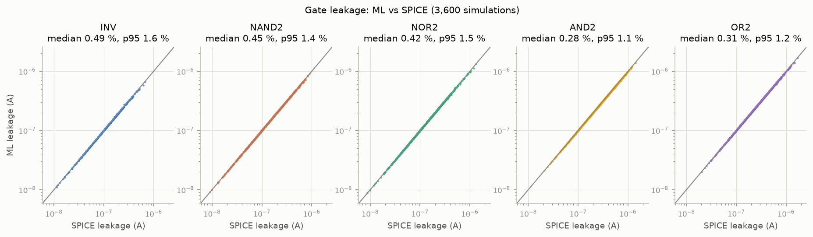

# Part B: gate leakage, ML vs SPICE

18 gate × input cases × 200 corners. Leakage = total current drawn from VDD-level sources: the VDD supply current plus the current drawn by the inputs held at VDD (`sim/gates.py`). Bias = median of (ML / SPICE − 1). Errors are per-simulation |ML − SPICE| / SPICE.

| gate | inputs | SPICE median (A) | ML median (A) | bias | median error | p95 error | mean error | median error, vdd-node sum | median error, minimal supernode | device-SPICE median error | ML-solved internal node vs SPICE (median \|ΔV\|) |
|---|---|---|---|---|---|---|---|---|---|---|---|
| INV | 0 | 1.098e-07 | 1.097e-07 | +0.26 % | 0.50 % | 1.66 % | 0.65 % | 6.80 % | 0.50 % | 0.0000 % | — |
| INV | 1 | 1.129e-07 | 1.125e-07 | -0.28 % | 0.48 % | 1.35 % | 0.58 % | 0.48 % | 0.48 % | 0.0001 % | — |
| NAND2 | 00 | 1.008e-07 | 1.016e-07 | +0.53 % | 0.57 % | 1.43 % | 0.67 % | 13.94 % | 0.57 % | 0.0000 % | x: 0.198 mV |
| NAND2 | 01 | 1.579e-07 | 1.586e-07 | +0.10 % | 0.34 % | 1.18 % | 0.48 % | 4.35 % | 0.34 % | 0.0000 % | x: 0.0081 mV |
| NAND2 | 10 | 9.068e-08 | 9.085e-08 | +0.29 % | 0.44 % | 1.47 % | 0.55 % | 8.63 % | 0.44 % | 0.0000 % | x: 0.327 mV |
| NAND2 | 11 | 2.256e-07 | 2.250e-07 | -0.23 % | 0.43 % | 1.35 % | 0.54 % | 0.43 % | 0.43 % | 0.0000 % | x: 0.0044 mV |
| NOR2 | 00 | 2.189e-07 | 2.188e-07 | +0.27 % | 0.48 % | 1.54 % | 0.62 % | 2.08 % | 0.48 % | 0.0000 % | y: 0.0145 mV |
| NOR2 | 01 | 1.668e-07 | 1.664e-07 | +0.06 % | 0.29 % | 1.38 % | 0.44 % | 3.79 % | 0.29 % | 0.0000 % | y: 0.015 mV |
| NOR2 | 10 | 9.702e-08 | 9.693e-08 | -0.21 % | 0.43 % | 1.55 % | 0.53 % | 0.43 % | 0.43 % | 0.0001 % | y: 0.229 mV |
| NOR2 | 11 | 8.966e-08 | 8.930e-08 | -0.33 % | 0.48 % | 1.43 % | 0.61 % | 0.50 % | 0.50 % | 0.0001 % | y: 0.136 mV |
| AND2 | 00 | 2.420e-07 | 2.419e-07 | +0.13 % | 0.30 % | 1.10 % | 0.40 % | 6.64 % | 0.30 % | 0.0000 % | x: 0.2 mV n: 0.0179 mV |
| AND2 | 01 | 2.823e-07 | 2.823e-07 | -0.17 % | 0.30 % | 1.16 % | 0.43 % | 1.90 % | 0.30 % | 0.0000 % | x: 0.00811 mV n: 0.0142 mV |
| AND2 | 10 | 2.128e-07 | 2.127e-07 | -0.12 % | 0.27 % | 1.18 % | 0.40 % | 2.83 % | 0.27 % | 0.0000 % | x: 0.329 mV n: 0.0144 mV |
| AND2 | 11 | 3.466e-07 | 3.457e-07 | -0.12 % | 0.28 % | 1.01 % | 0.41 % | 2.12 % | 0.28 % | 0.0000 % | x: 0.00953 mV n: 0.016 mV |
| OR2 | 00 | 3.478e-07 | 3.475e-07 | -0.21 % | 0.38 % | 1.27 % | 0.53 % | 1.45 % | 0.38 % | 0.0000 % | y: 0.0274 mV n: 0.0416 mV |
| OR2 | 01 | 2.875e-07 | 2.874e-07 | +0.12 % | 0.32 % | 1.05 % | 0.42 % | 4.93 % | 0.32 % | 0.0000 % | y: 0.015 mV n: 0.00705 mV |
| OR2 | 10 | 2.230e-07 | 2.233e-07 | +0.00 % | 0.28 % | 1.01 % | 0.40 % | 3.32 % | 0.28 % | 0.0000 % | y: 0.228 mV n: 0.0065 mV |
| OR2 | 11 | 2.299e-07 | 2.296e-07 | -0.02 % | 0.28 % | 1.33 % | 0.44 % | 3.04 % | 0.35 % | 0.0000 % | y: 0.136 mV n: 0.00762 mV |

**All 3,600 gate simulations:** median error 0.37 %, p95 1.33 %, mean 0.51 %, 89 % of simulations within 1 %.

The VDD supply current alone (without the input currents) is predicted to median 0.43 %, p95 1.51 %, mean 0.57 %.

**Device-SPICE check** (same recipe, each transistor simulated alone instead of the ML model): median 0.0000 %, p95 0.0002 %, max 0.0004 % (vdd-node sum: median 0.0001 %, max 0.0005 %). So the recipe itself is exact; the remaining error is the transistor models'.

**How the device currents are combined** (`ml/gate_eval.py`), all 3,600 simulations:

| method | median | p95 | mean |
|---|---|---|---|
| sum at the vdd node | 2.43 % | 18.20 % | 5.17 % |
| minimal supernode (vdd + ON-connected nodes) | 0.38 % | 1.37 % | 0.52 % |
| **best cut (used)** | **0.37 %** | **1.33 %** | **0.51 %** |

**Internal node voltages.** The ML leakage uses the SPICE-recorded node voltages (doc step 4). For the record, the last column also gives ML's own estimate: the voltage where the ML device currents into the node balance (KCL, `ml/gate_eval.solve_internal_nodes`). Per gate case and node it agrees with SPICE to a median of 0.33 mV or better (p95 at most 1.7 mV). It fails in a few corners where the balance hinges on an ON device at a drain-source voltage of microvolts, the region the uniformly sampled training data barely covers: worst OR2 10, node y, 773 mV.

