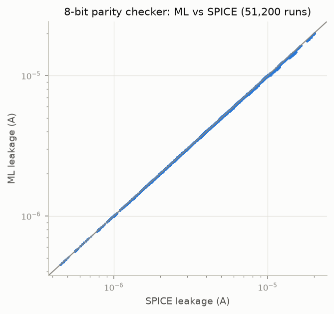

# Part C: 8-bit parity checker, hierarchical ML vs SPICE

7 XOR2 in a tree, each XOR2 = 4 NAND2 (28 NAND2, 112 transistors). 256 input vectors × the 200 Part B corners = 51,200 full-netlist SPICE runs. ML = sum of the 28 NAND2 gate-model leakages (each gate model = the Part B transistor models). Leakage = VDD supply current + current drawn by the inputs held at VDD (`sim/gates.py`).

| set | runs | SPICE median (A) | ML median (A) | bias | median error | p95 error | mean error | same sum with SPICE gates: median error |
|---|---|---|---|---|---|---|---|---|
| all | 51,200 | 4.761e-06 | 4.747e-06 | -0.22 % | 0.38 % | 1.35 % | 0.51 % | 0.18 % |
| 0 inputs high | 200 | 4.961e-06 | 4.952e-06 | -0.14 % | 0.34 % | 1.28 % | 0.49 % | 0.15 % |
| 1 input high | 1,600 | 4.852e-06 | 4.865e-06 | -0.17 % | 0.35 % | 1.35 % | 0.50 % | 0.17 % |
| 2 inputs high | 5,600 | 4.799e-06 | 4.790e-06 | -0.20 % | 0.35 % | 1.35 % | 0.50 % | 0.17 % |
| 3 inputs high | 11,200 | 4.757e-06 | 4.730e-06 | -0.21 % | 0.36 % | 1.38 % | 0.51 % | 0.18 % |
| 4 inputs high | 14,000 | 4.733e-06 | 4.718e-06 | -0.23 % | 0.38 % | 1.32 % | 0.50 % | 0.18 % |
| 5 inputs high | 11,200 | 4.761e-06 | 4.745e-06 | -0.24 % | 0.39 % | 1.37 % | 0.52 % | 0.19 % |
| 6 inputs high | 5,600 | 4.735e-06 | 4.732e-06 | -0.25 % | 0.40 % | 1.33 % | 0.52 % | 0.19 % |
| 7 inputs high | 1,600 | 4.726e-06 | 4.718e-06 | -0.25 % | 0.41 % | 1.34 % | 0.54 % | 0.20 % |
| 8 inputs high | 200 | 4.821e-06 | 4.780e-06 | -0.25 % | 0.40 % | 1.28 % | 0.54 % | 0.17 % |

## Where the error comes from

- **Composition** (sum of stand-alone SPICE NAND2 leakages vs the full netlist): median 0.18 %, p95 0.93 %, max 2.15 %. It comes from internal inputs not sitting exactly at 0 or VDD and from the next gate's input current slightly shifting each node.
- **ML vs that SPICE gate sum:** median 0.24 %, p95 1.03 %.
- **With the VDD supply current alone** as the leakage, the same sum of SPICE gate values misses the circuit by 23.9 % median (p95 60.7 %): inside the circuit, the input current of an internal net at logic 1 is supplied by its driver's VDD, which a stand-alone gate's VDD current does not include.

